# CPSC 449 Lab 10: Cloud Database and Backend Deployment

## Overview

In this lab, you will move the **Movie Manager** application from a local development environment to online services. The application is built with Node.js, Express, Mongoose, HTML, CSS, and browser JavaScript.

MongoDB Atlas hosts the movie database, while Render hosts the Express backend and static frontend. Connecting Render to GitHub enables the service to redeploy when changes are pushed to the repository. This setup demonstrates cloud database configuration, environment-variable management, application deployment, and production troubleshooting.

Your main task is to configure an Atlas cluster, populate it with sample movie and review data, deploy the application, and verify that the public service can read and modify the cloud-hosted data.

## Learning Objectives

By the end of this lab, you should be able to:

- Explain the roles of a cloud database and an application-hosting service.
- Create and configure a MongoDB Atlas cluster.
- Store a database connection string securely in an environment variable.
- Seed a cloud database with a Node.js script.
- Deploy an Express application to Render.
- Connect a hosting service to a GitHub repository for automatic deployment.
- Configure network access between a hosted backend and MongoDB Atlas.
- Verify a deployment with browser requests, application logs, and database tools.
- Diagnose common database and deployment failures.

## Before You Start

1. Install Node.js and npm if they are not already installed.
2. Create accounts for MongoDB Atlas, GitHub, and Render.
3. Install MongoDB Compass or prepare another database client if you want to inspect the data directly.
4. Make sure the project is committed to a GitHub repository that Render can access.

Verify Node.js and npm from a terminal:

```bash
node -v
npm -v
```

Never commit an Atlas password, connection string, or other secret to GitHub. The repository includes `.env.sample` as a template; keep your real values in a local `.env` file and in Render's environment-variable settings.

## Project Structure

```text
.
|-- images/
|   |-- mongodb_atlas_free_tier.png
|   |-- mongodb_atlas_free_tier_2.png
|   |-- mongodb_atlas_free_tier_3.png
|   |-- mongodb_atlas_free_tier_4.png
|   |-- mongodb_atlas_free_tier_5.png
|   |-- mongodb_atlas_free_tier_6.png
|   |-- mongodb_atlas_free_tier_7.png
|   |-- mongodb_atlas_free_tier_8.png
|   |-- profile_img.png
|   |-- render.png
|   |-- render2.png
|   |-- render3.png
|   |-- render4.png
|   |-- render5.png
|   |-- render6.png
|   `-- render7.png
|-- models/
|   |-- Movie.js
|   `-- Review.js
|-- public/
|   |-- details.html
|   |-- details.js
|   |-- manager.html
|   |-- manager.js
|   `-- styles.css
|-- .env.sample
|-- .gitignore
|-- package.json
|-- package-lock.json
|-- populateData.js
`-- server.js
```

- `server.js` configures Express, serves the frontend and image assets, connects to Atlas, and exposes the movie and review routes.
- `populateData.js` replaces the existing movie and review data with the provided sample records.
- `models/Movie.js` and `models/Review.js` define the Mongoose models.
- `public/manager.html` and `public/manager.js` provide the online movie-management interface.
- `public/details.html` and `public/details.js` provide the movie-details starter interface.
- `images/` contains the application avatar and the setup screenshots used in this README.
- `.env.sample` documents the required `MONGO_URI` variable without exposing a real credential.

## Setup and Running the App

1. Open a terminal in the project directory.
2. Install the dependencies:

   ```bash
   npm install
   ```

3. Copy `.env.sample` to `.env` and replace the placeholders with your own Atlas values:

   ```env
   MONGO_URI=mongodb+srv://<username>:<password>@<cluster>/<database_name>
   ```

   URL-encode any special characters in the username or password.

4. Populate the database:

   ```bash
   node populateData.js
   ```

   This command deletes the movies and reviews currently in the selected database before inserting the sample data. Confirm that `MONGO_URI` points to the intended database before running it.

5. Start the development server:

   ```bash
   npm run dev
   ```

6. Open the manager dashboard:

   ```text
   http://localhost:3000/manager.html
   ```

Keep the server terminal open while testing so you can inspect database, request, and error output.

## Application Routes

| Method | Route | Expected behavior |
| --- | --- | --- |
| `GET` | `/movies` | Return all movies. |
| `POST` | `/movies` | Create a movie from `name`, `genre`, and `rating`. |
| `GET` | `/movies/:id` | Return one movie by its MongoDB ID. |
| `PUT` | `/movies/:id` | Update a movie by its MongoDB ID. |
| `DELETE` | `/movies/:id` | Delete a movie by its MongoDB ID. |
| `GET` | `/movies/:id/reviews` | Return the reviews associated with a movie. |

The browser calls these Express routes over HTTP. Mongoose translates the route operations into reads and writes against the database selected by `MONGO_URI`.

## MongoDB Atlas Setup

Use the following screenshots as a reference. Atlas may change its interface, so labels and page layouts can differ slightly.

1. Create a project and choose the free cluster option.

   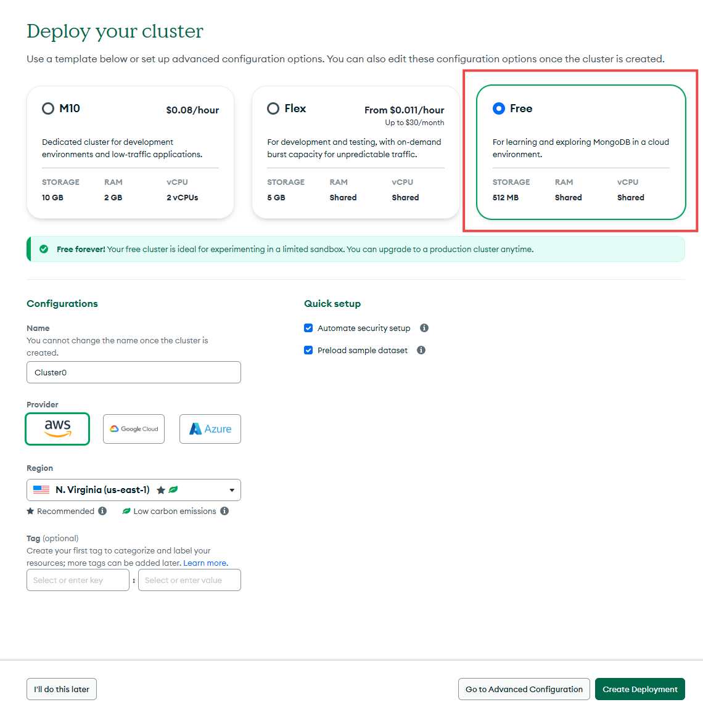

2. Create a database user with a strong, unique password.

   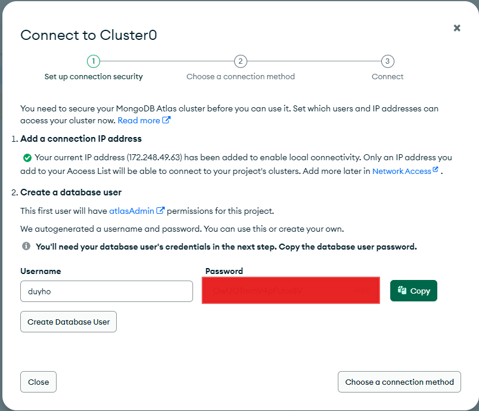

3. Choose MongoDB Compass as the connection method.

   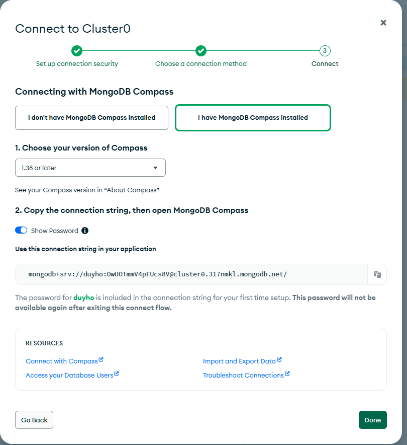

4. Copy the connection string into Compass and give the connection a recognizable name.

   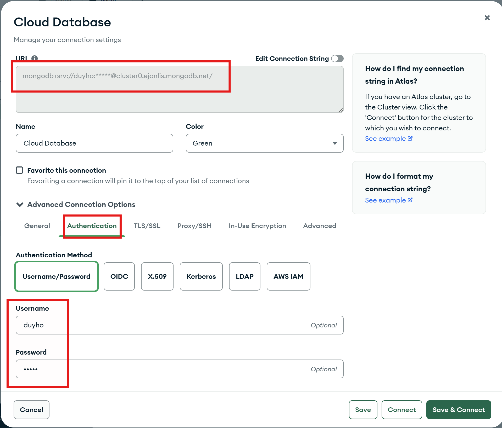

5. Verify that Compass can connect to the cluster.

   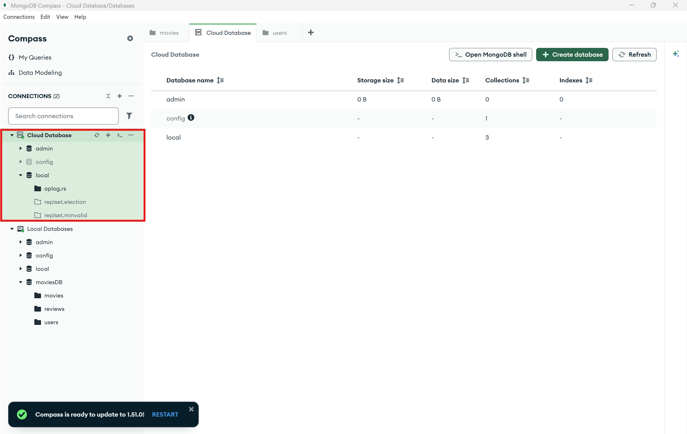

6. Add the Atlas connection string to `.env`, run `node populateData.js`, and verify that the sample records were inserted.
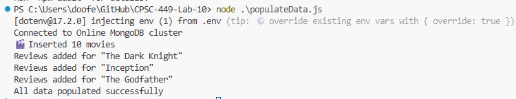

   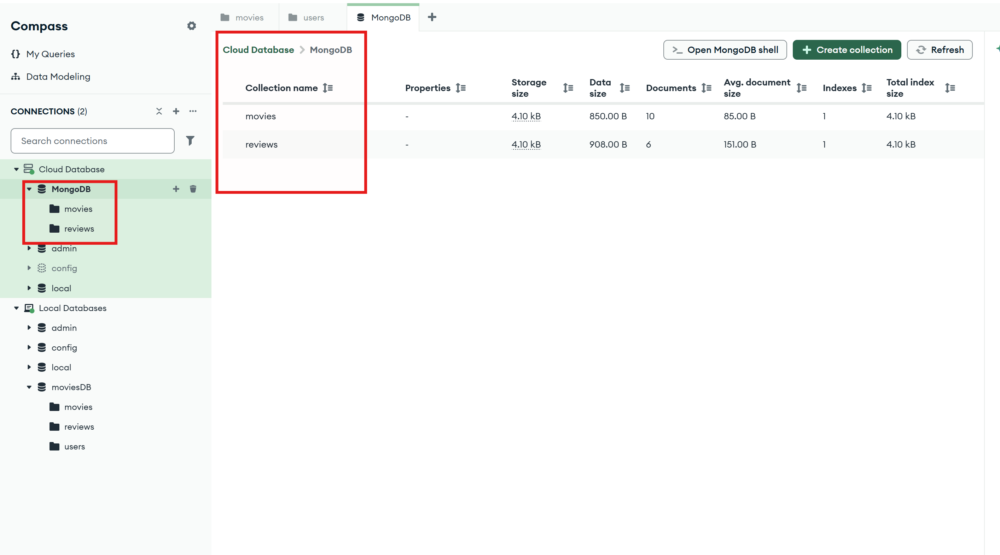

## Render Deployment

Before deploying, configure Atlas Network Access so the hosted application can reach the cluster. Use Render's current outbound IP ranges for your service and limit access as narrowly as the platform permits.

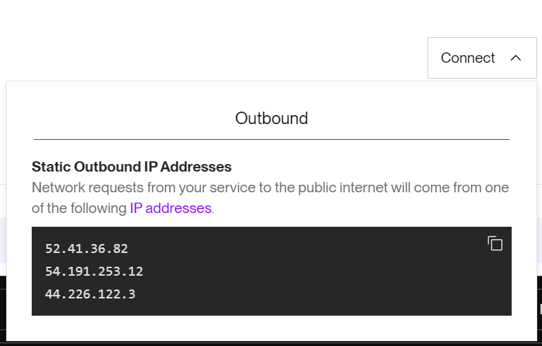


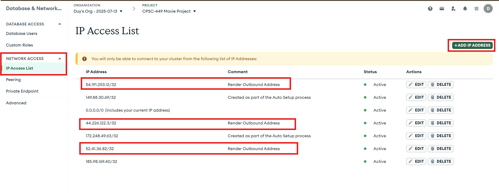

1. Sign in to Render and connect your GitHub account.

   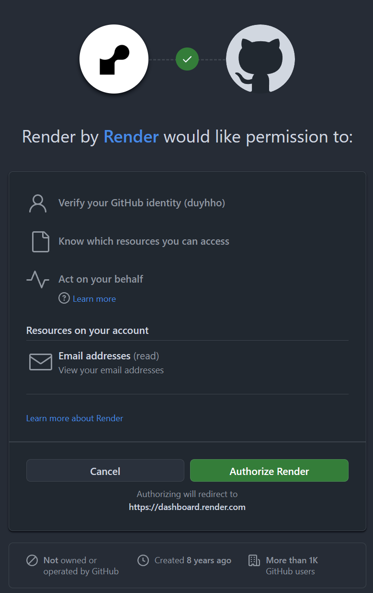

2. Create a new Web Service.

   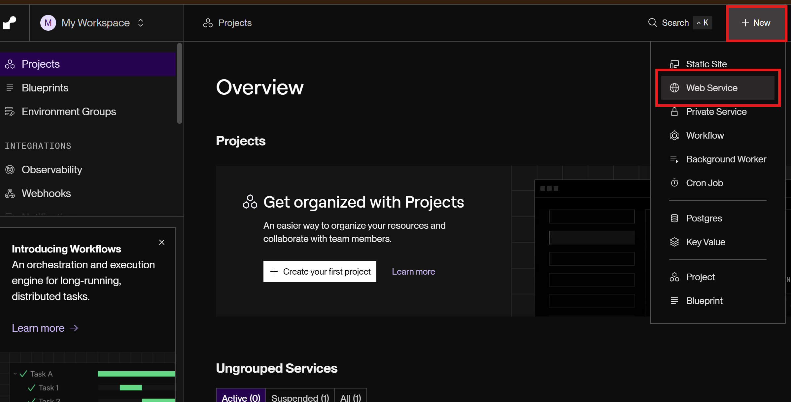

3. Select the GitHub repository for this lab.

   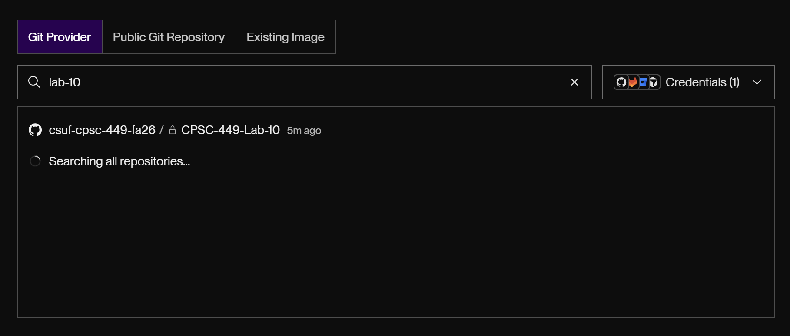

   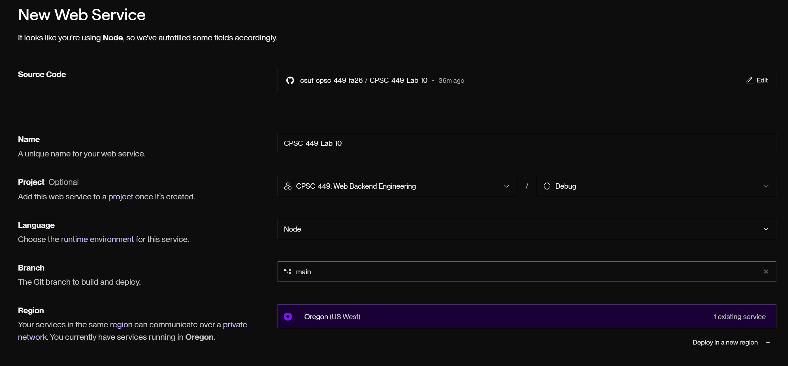

4. Configure the service:

   ```text
   Build command: npm install
   Start command: npm start
   ```

   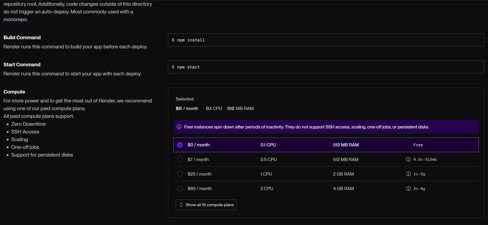

5. Add `MONGO_URI` as a Render environment variable. Do not place the value in the repository or show it in screenshots.

6. Deploy the service and wait for the build to finish.

   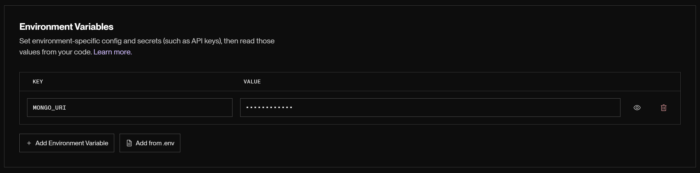

7. Open the public service URL and verify that the dashboard loads.

   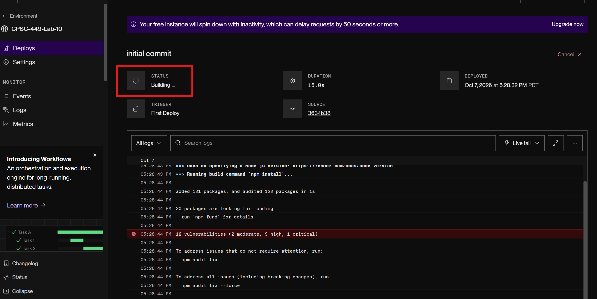

   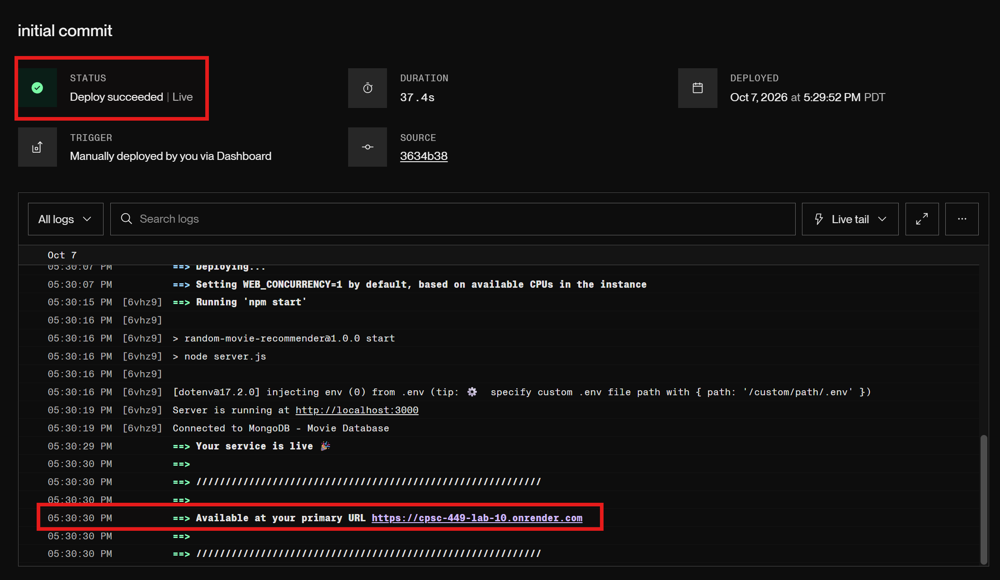

8. Inspect the Render logs for a successful database connection, then test redeployment by pushing a small change to GitHub.

   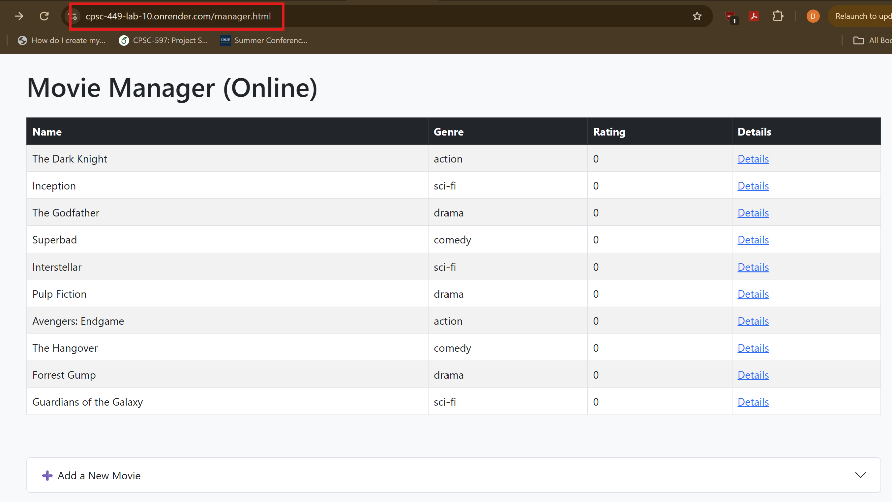

## Student TODOs

Complete the TODOs in order. Verify each step before moving to the next one.

### TODO 1: Run and Inspect the Starter

1. Install the dependencies and create a local `.env` file.
2. Start the server with `npm run dev`.
3. Open `manager.html` through Express and load the movie list.
4. Identify where `server.js`, the Mongoose models, and the browser scripts exchange data.
5. Confirm that `.env` is ignored by Git before continuing.

### TODO 2: Create and Populate the Atlas Database

1. Create an Atlas cluster and database user.
2. Configure Network Access for your current development machine.
3. Add the correct connection string to the local `.env` file.
4. Run `node populateData.js`.
5. Use Compass or the Atlas data explorer to confirm that the movie and review documents exist.

Do not run the population script against a database containing data you need to keep because it calls `deleteMany()` before inserting the sample records.

### TODO 3: Test the Cloud-Backed App Locally

1. Restart the Express server after changing `.env`.
2. Confirm that `GET /movies` returns the Atlas data.
3. Add a movie from the manager dashboard.
4. Open a movie's details page and verify its ID-based request.
5. Check Atlas or Compass to confirm that changes persist outside the local process.

### TODO 4: Deploy to Render

1. Push the completed project to GitHub without `.env`.
2. Create the Render Web Service with the correct build and start commands.
3. Add `MONGO_URI` in Render's environment settings.
4. Allow the required Render outbound addresses in Atlas Network Access.
5. Deploy and review the complete build and runtime logs.
6. Open the public `/manager.html` URL and exercise the movie routes.

### TODO 5: Document and Submit

1. Capture the Atlas cluster or collections without revealing credentials.
2. Capture the deployed manager dashboard at its public Render URL.
3. Capture a successful Render deployment or log output.
4. Briefly explain how the hosted backend connects to Atlas and how GitHub triggers deployment.
5. Confirm one final time that no passwords or connection strings are committed or visible in screenshots.

## Completion Checklist

- [ ] Node.js dependencies are installed and the application runs locally.
- [ ] `.env` contains the Atlas connection locally and is ignored by Git.
- [ ] Atlas contains the sample movie and review data.
- [ ] The local Express server can read and modify the Atlas data.
- [ ] The GitHub repository contains no credentials or secrets.
- [ ] Render builds and starts the application successfully.
- [ ] Render has the required `MONGO_URI` environment variable.
- [ ] Atlas Network Access permits the deployed service to connect.
- [ ] The public dashboard and API routes work as expected.
- [ ] Application and deployment logs show no unexpected errors.

## Submission Requirements

Submit the items required by your instructor, including:

1. A screenshot of your MongoDB Atlas cluster or cloud database data.
2. A screenshot of the backend running at its public hosting URL.
3. A screenshot of a successful deployment or relevant runtime logs.
4. A brief explanation of your hosting choice, deployment workflow, and database connection.
5. Your completed project files in the correct repository and branch.

Before submitting, confirm that every screenshot is readable and contains no database password, connection string, or other secret. Do not commit `.env` or `node_modules/`.

## Troubleshooting

### The server does not start

- Run `npm install` and try `npm run dev` again.
- Confirm that `MONGO_URI` exists in `.env` and uses a valid URI.
- Confirm that port `3000` is not already in use.
- Read the complete error shown in the server terminal.

### Atlas rejects the connection

- Confirm that the database username and password are correct.
- URL-encode special characters in credentials.
- Check Atlas Network Access for the client or Render outbound address.
- Confirm that the database user has permission to access the selected database.
- Restart the server after changing environment variables.

### The Render build fails

- Inspect the first meaningful error in the build log.
- Confirm that `package.json` and `package-lock.json` are committed.
- Verify that the build command is `npm install` and the start command is `npm start`.
- Confirm that the Node.js version and dependencies are compatible.

### The deployment starts but the app cannot load movies

- Check the Render runtime logs for a Mongoose connection error.
- Confirm that `MONGO_URI` is set for the correct Render service and environment.
- Check Atlas Network Access and database-user permissions.
- Open `/movies` directly on the deployed service to isolate an API failure from a browser-interface problem.

### Changes do not appear online

- Confirm that the latest commit was pushed to the branch Render deploys.
- Check whether automatic deployment is enabled.
- Review the most recent deployment status and logs.
- Trigger a manual deploy if the linked branch is current but no deployment started.
